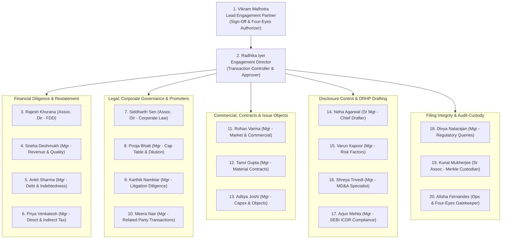
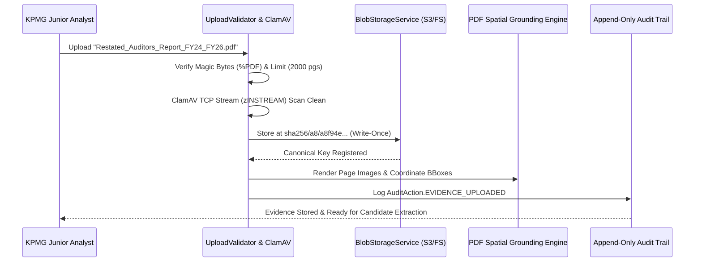
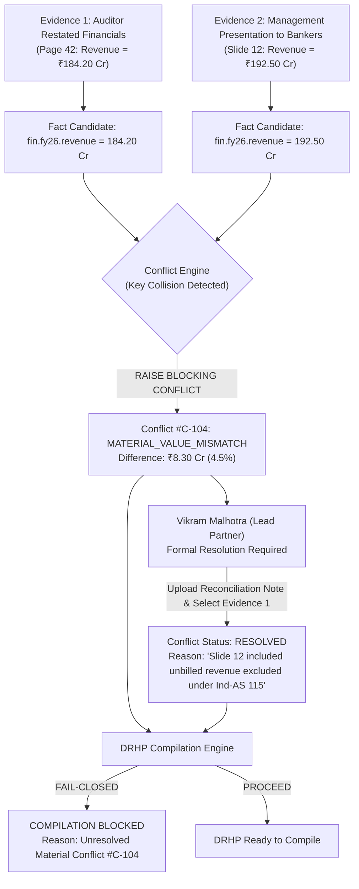
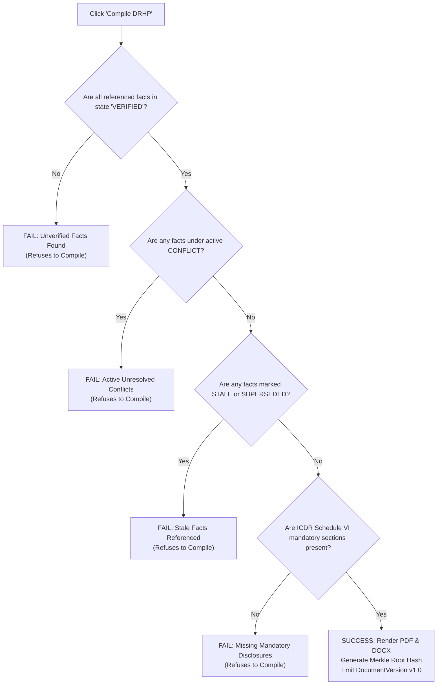
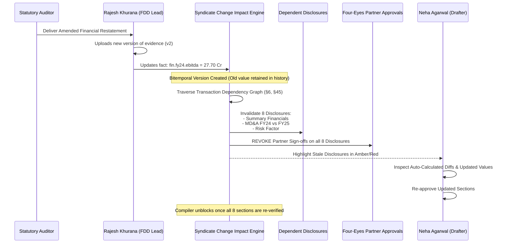

# Syndicate × KPMG Deal Advisory: Operational Architecture & Execution Manual
## End-to-End IPO Delivery Workflow for a 20-Person Core Engagement Team and Sub-Teams

---

## 1. First-Principles Foundation: Why Traditional IPO Delivery Fails and How Syndicate Solves It

### 1.1 The Root Cause: The "Document Trap" vs. The "Information State Problem"

In investment banking, transaction advisory, and capital markets practices, an Initial Public Offering (IPO) is almost universally treated as a **document-production problem**: the engagement team drafts the Draft Red Herring Prospectus (DRHP) in Microsoft Word, circulates revisions via email threads, maintains financial schedules in disparate spreadsheets, and holds review meetings over markups.

Under first principles, this approach is fatally flawed:
- **The DRHP is not the transaction; it is merely a derived serialization.** An offer document is a 400-to-600 page derived artifact of an underlying **information state**.
- **State Fragmentation:** During an IPO, truth is scattered across:
  1. *Source Evidence:* Audited financial statements, MCA filings, Board resolutions, vendor master contracts, title deeds, sanction letters, and court dockets.
  2. *Extracted Observations:* Numbers, names, dates, and claims pulled from evidence.
  3. *Derived Disclosures:* Restated summaries, risk factors, objects of the issue, and capitalization tables.
- **The Multi-Author Divergence Problem:** When 20 core advisors plus 30 junior associates, legal counsels, merchant bankers, and company executives edit a monolithic document simultaneously:
  - The same financial figure appears in 14 distinct sections (Summary Financial Information, Capital Structure, Financial Indebtedness, MD&A, Risk Factors, Basis for Issue Price, etc.).
  - A statutory auditor restates revenue by ₹4.35 Crore due to Ind-AS 115 revenue cut-off adjustments late on a Thursday night.
  - The restatement is updated in the financial annexures, but **nobody remembers that the same figure is quoted in Risk Factor #3, MD&A paragraph 4, and the Merchant Banker presentation**.
  - The DRHP is filed with SEBI containing conflicting representations. SEBI issues formal queries ("Observations"), halting the issue, generating negative publicity, and extending the transaction timeline by 4 to 8 months.

```
Traditional Delivery (Document-Centric):
  [Evidence PDFs] ---> [Manual Copy-Paste] ---> [500-Page Word Doc] <--- 50 People Editing
                                                    |
                                    (Silent Desynchronization)
                                                    v
                                      SEBI Rejection / Delays

Syndicate Delivery (State-Centric):
  [Evidence PDFs] ---> [Cryptographic Ingestion & Spatial Grounding (BBox)]
                                |
                                v
               [Zero AI Authority Extraction -> Candidate Facts]
                                |
                                v
               [Human Four-Eyes Verification -> Canonical Facts]
                                |
                                v
             [Conflict Engine: Auto-Flags Contradictions]
                                |
                                v
     [Dynamic Disclosures: Placeholders bound to Fact Semantic Keys]
                                |
                                v
  [Fail-Closed Compiler] ===> Verified PDF / DOCX DRHP + Cryptographic Merkle Manifest
```

### 1.2 Syndicate's Guiding Invariants

Syndicate eliminates document drift by enforcing ten non-negotiable operational invariants:
1. **Preserve the Source:** Source evidence is immutable, SHA-256 hashed, content-addressed, and spatially grounded down to bounding box coordinates on specific PDF pages.
2. **Zero AI Authority:** Machine learning and LLMs only suggest candidates; they possess zero authority to establish transaction truth.
3. **Four-Eyes Verification:** Critical facts require two distinct human beings (Maker-Checker): an analyst accepts a candidate fact, and an independent senior advisor verifies it.
4. **Explicit Conflict Resolution:** Two contradictory pieces of evidence cannot coexist quietly. The system blocks compilation until a named authorized person records a formal resolution reason.
5. **Dynamic Placeholder Compilation:** Disclosures never hardcode values. They reference semantic fact keys (e.g., `{{fact:fin.fy26.revenue}}`).
6. **Automatic Downstream Invalidation:** When a fact changes, all dependent claims, disclosures, and formal partner approvals are instantly invalidated and flagged as stale.
7. **Fail-Closed Compilation:** If any referenced fact is stale, unverified, or in conflict, the DRHP compiler refuses to emit a clean regulatory document.
8. **Bitemporal Tracking:** Every fact records two timelines: *business validity time* (when it was true in the real world) and *system transaction time* (when Syndicate learned of it).
9. **Regulatory Audit Chain:** Every single keystroke, upload, verification, and rejection is recorded in an immutable append-only Merkle-linked audit trail.
10. **Controlled Observation Loop:** Regulatory queries from SEBI or Stock Exchanges link directly to affected disclosures, generating audited statements of changes.

---

## 2. The 20-Person KPMG Core Engagement Team Hierarchy & Sub-Teams

To deliver a high-stakes IPO for an issuer (e.g., *Trinity Capital Limited* or an enterprise SME IPO), KPMG deploys a multidisciplinary cross-functional team of **20 dedicated senior professionals**, each leading a sub-team of senior consultants, associates, and data analysts.



### Complete Roster, System Permissions, and Sub-Team Breakdown

| # | Professional Name | KPMG Designation | Syndicate Transaction Role | Sub-Team Size & Composition | Primary Operational Focus in Syndicate |
|---|---|---|---|---|---|
| **1** | **Vikram Malhotra** | Lead Partner & Head of Capital Advisory | `LEAD_PARTNER` / Sign-off Authority | 1 Executive Assistant, 1 Director | Final DRHP sign-off, four-eyes authorization on material conflicts, regulatory lock undertakings. |
| **2** | **Radhika Iyer** | Engagement Director | `TRANSACTION_CONTROLLER` / Verifier | 2 Associate Directors | Milestone progression, transaction state machine gating, inter-workstream dispute resolution. |
| **3** | **Rajesh Khurana** | Associate Director – Financial Diligence | `FDD_LEAD` / Verifier | 4 Senior Consultants, 6 Analysts | Ind-AS restated standalone/consolidated financial statements (FY24-FY26), accounting policies. |
| **4** | **Sneha Deshmukh** | Manager – Revenue & Earnings Quality | `FACT_VERIFIER` | 2 Consultants, 3 Analysts | Revenue recognition audits, EBITDA normalizations, spatial evidence grounding of sales ledgers. |
| **5** | **Ankit Sharma** | Manager – Debt & Working Capital | `FACT_VERIFIER` | 2 Consultants, 2 Analysts | Borrowing facilities, sanction letters, non-fund based limits, debentures, charge satisfactions. |
| **6** | **Priya Venkatesh** | Manager – Direct & Indirect Tax | `FACT_VERIFIER` | 2 Tax Consultants, 2 Analysts | Tax returns (ITR/GST), tax demand appeals, pending assessments, contingent tax liabilities. |
| **7** | **Siddharth Sen** | Associate Director – Corporate Legal | `LEGAL_LEAD` / Verifier | 3 Senior Consultants, 4 Analysts | MoA/AoA amendments, Board/EGM resolutions, secretarial audit reconciliation, ROC filings. |
| **8** | **Pooja Bhatt** | Manager – Capital Structure & Cap Table | `CAP_TABLE_LEAD` / Verifier | 2 Corporate Consultants, 2 Analysts | Share allotments since inception, bonus issues, ESOP pool, promoter pre-IPO dilution and lock-in. |
| **9** | **Karthik Nambiar** | Manager – Litigation & Regulatory Scrutiny | `LITIGATION_VERIFIER` | 3 Legal Analysts | Outstanding litigation search, MCA/NCLT/SEBI enforcement dockets, criminal/civil litigation sheets. |
| **10** | **Meera Nair** | Manager – Related Party Transactions | `RPT_VERIFIER` | 2 Consultants, 2 Analysts | Section 188 Companies Act compliance, arm's length certificates, omnibus approvals, promoter loans. |
| **11** | **Rohan Varma** | Manager – Commercial & Market Diligence | `COMMERCIAL_LEAD` | 2 Industry Analysts | CRISIL/CareEdge industry reports, addressable market sizing, macro-economic disclosures. |
| **12** | **Tanvi Gupta** | Manager – Material Contracts Diligence | `CONTRACTS_VERIFIER` | 3 Consultants, 3 Analysts | Top 10 customer/supplier agreements (5% revenue threshold), exclusivity clauses, termination liabilities. |
| **13** | **Aditya Joshi** | Manager – Objects of Issue & Capex | `CAPEX_VERIFIER` | 2 Consultants, 2 Analysts | Use of proceeds breakdown, vendor quotations, civil engineering estimates, schedule of implementation. |
| **14** | **Neha Agarwal** | Senior Manager – Chief DRHP Drafter | `CHIEF_DRAFTER` | 3 Technical Writers, 4 Consultants | Section template drafting, placeholder binding, fail-closed DRHP compilations in PDF and DOCX. |
| **15** | **Varun Kapoor** | Manager – Risk Factors Drafter | `DISCLOSURE_DRAFTER` | 2 Consultants, 2 Analysts | Risk factor prioritization, material sensitivity linkages to FDD and litigation facts. |
| **16** | **Shreya Trivedi** | Manager – MD&A Drafter | `DISCLOSURE_DRAFTER` | 2 Consultants, 2 Analysts | Management Discussion and Analysis, period-over-period variance narratives tied to verified financial facts. |
| **17** | **Arjun Mehta** | Manager – Regulatory Checklists | `COMPLIANCE_CONTROLLER` | 2 Compliance Analysts | SEBI ICDR Schedule VI checklists, Stock Exchange SME listing criteria, eligibility certificates. |
| **18** | **Divya Natarajan** | Manager – Regulatory Queries & Observations | `OBSERVATION_MANAGER` | 2 Senior Analysts | Ingestion of SEBI/BSE observation letters, query tasking, formal statements of changes. |
| **19** | **Kunal Mukherjee** | Senior Associate – Merkle Audit & Security | `PROVENANCE_CUSTODIAN` | 1 Cryptographic Specialist | SHA-256 evidence hashing, Merkle manifest audits, bitemporal point-in-time state reconstruction. |
| **20** | **Alisha Fernandes** | Operations & Quality Assurance Lead | `QA_OPERATIONS_LEAD` | 2 Operations Coordinators | Four-eyes maker-checker routing, task SLAs, user access & TOTP MFA governance, audit export verification. |

---

## 3. The 6 Core Workstreams in Syndicate

Every IPO transaction on Syndicate is partitioned into **6 isolated, cryptographically auditable Workstreams**. Each workstream operates with strict role-based access control (RBAC), multi-tenancy organization isolation, and four-eyes verification pipelines.

```
+---------------------------------------------------------------------------------------------------+
|                                 TRANSACTION: TRINITY CAPITAL IPO                                  |
+---------------------------------------------------------------------------------------------------+
|  1. FINANCIAL DILIGENCE (FDD)        |  2. CAPITAL STRUCTURE & GOVERNANCE  |  3. LITIGATION & RPT     |
|  - Restated P&L, BS, Cash Flow       |  - Share Allotment Lineage (1998+)  |  - Civil & Tax Dockets   |
|  - Working Capital & Borrowings      |  - Demat & ISIN Setup               |  - ROC Inquiries         |
|  - Direct & Indirect Tax Clearance   |  - Promoter Lock-in Undertakings    |  - Section 188 RPT Audit |
+---------------------------------------------------------------------------------------------------+
|  4. COMMERCIAL & OBJECTS OF ISSUE    |  5. DISCLOSURE & DRHP COMPILER      |  6. REGULATORY & QUERIES |
|  - Top 10 Customers / Vendors        |  - Dynamic Placeholder Templates    |  - SEBI Observations     |
|  - Industry Report Sizing            |  - Provenance-Stamped PDF/DOCX      |  - Stock Exchange Query  |
|  - Civil Capex & Vendor Quotations   |  - Automated Dependency Graph       |  - Statement of Changes  |
+---------------------------------------------------------------------------------------------------+
```

---

## 4. End-to-End Operational Lifecycle: Step-by-Step Walkthrough

Below is the exact chronological procedure through which the KPMG 20-person team and their 50+ supporting analysts execute an IPO from mandate kickoff to final listing submission on Syndicate.

---

### Phase 1: Engagement Setup, Security Boundary & Multi-Factor Governance

**Primary Actors:** Alisha Fernandes (Ops Lead), Vikram Malhotra (Lead Partner), Radhika Iyer (Engagement Director).

#### 1.1 Secure Authentication and Organization Isolation (§51–52)
1. **Access Tokens & Session Cookies:**
   - Every KPMG user logs in through `https://syndicate.kpmg.internal/login`.
   - Syndicate mints an access token valid for **only 15 minutes** stored in volatile application memory, paired with an `HttpOnly`, `SameSite=Strict`, AES-encrypted rotating refresh cookie (`syndicate_session`).
2. **Mandatory TOTP MFA Enforcement:**
   - Because KPMG team members act as certifying verifiers for public market disclosures, **RFC 6238 TOTP two-factor authentication** is strictly enforced.
   - On initial setup, Alisha Fernandes verifies that all 20 leaders and their analysts register their authenticators (Google Authenticator / 1Password) via `/api/auth/mfa/setup`.
   - **Lockout Protection:** If an unauthorized party attempts 5 incorrect passwords on any KPMG account, Syndicate's DB-backed lockout engine locks the account for 15 minutes (`locked_until`), logging an alert to Micrometer/Prometheus (`syndicate.auth.lockouts`).
3. **Transaction Provisioning:**
   - Vikram Malhotra creates the transaction: `Trinity Capital Limited — SME IPO Reference`.
   - He designates Radhika Iyer as the `TRANSACTION_CONTROLLER`.
   - Radhika provisions the 6 core workstreams and issues invitation tokens to the remaining 18 team leads with their exact granular scopes.

---

### Phase 2: Evidence Ingestion, Hash-Locking & Spatial Grounding

**Primary Actors:** Rajesh Khurana's team (FDD), Siddharth Sen's team (Legal), Tanvi Gupta's team (Contracts).
**Sub-Team Action:** 15 Junior Analysts.



#### 2.1 Content-Addressed Storage & Upload Guardrails (§50, §51)
- Junior Analyst *Arun Verma* (under Rajesh Khurana) receives the audited financial report: `Auditor_Report_FY26_Restated.pdf`.
- He navigates to **Workstream 1 (Financial Diligence)** and uploads the document.
- **Upload Safety Gate:**
  1. `UploadValidator` inspects the magic bytes: verifies `%PDF-1.7` signature.
  2. PDFBox bounds memory: verifies file has fewer than 2,000 pages to prevent decompression bombs.
  3. `ClamAvMalwareScanner` pipes the file stream to ClamAV over TCP; scan returns `OK`.
  4. Syndicate hashes the content: `sha256 = "a8f94e63b712..."`.
  5. `BlobStorageService` stores the blob immutably under `sha256/a8/a8f94e63b712...`. If this exact file is uploaded elsewhere, Syndicate resolves it as write-once idempotent storage.

#### 2.2 Spatial Grounding with Visual Bounding Boxes (§7.2, §45)
- Syndicate immediately executes background PDF rendering and OCR extraction.
- The analyst opens the **Spatial Evidence Grounding Viewer**.
- When Arun highlights the statement: *"Revenue from operations for the financial year ended March 31, 2026 stood at ₹18,420.50 Lakhs"*, Syndicate records the exact spatial geometry:
  ```json
  {
    "pageNumber": 42,
    "bbox": { "x": 112.5, "y": 485.2, "width": 380.0, "height": 18.4 },
    "extractedText": "Revenue from operations for the financial year ended March 31, 2026 stood at ₹18,420.50 Lakhs"
  }
  ```
- **Why this matters for KPMG:** If SEBI or a Lead Manager questions the revenue 6 months later, clicking the fact in Syndicate instantly opens page 42 with a bright blue highlighter bounding box on the exact sentence in the signed PDF. No more digging through 20 folders.

---

### Phase 3: Zero AI Candidate Extraction & Review Boundary

**Primary Actors:** Sneha Deshmukh (Revenue Mgr), Ankit Sharma (Debt Mgr), Pooja Bhatt (Cap Table Mgr).
**Sub-Team Action:** 8 Senior Consultants.

```
+------------------------------------------------------------------------------------+
| SYNDICATE ZERO AI AUTHORITY BOUNDARY (§26)                                         |
|                                                                                    |
|  [Document Text] ---> [Claude / LLM Model]                                         |
|                             |                                                      |
|                             v                                                      |
|                   [AI Candidate Output]                                            |
|                             |                                                      |
|          +------------------x-------------------+                                  |
|          | CANNOT become a Fact directly        |                                  |
|          | CANNOT mutate Transaction Graph      |                                  |
|          | CANNOT be cited in Disclosures       |                                  |
|          +------------------+-------------------+                                  |
|                             |                                                      |
|                             v                                                      |
|              [Human Analyst Accept / Reject]                                       |
|                             |                                                      |
|                             v                                                      |
|                 [Four-Eyes Verification]                                           |
|                             |                                                      |
|                             v                                                      |
|                      [Canonical Fact]                                              |
+------------------------------------------------------------------------------------+
```

#### 3.1 AI Extraction Under Zero Authority (§26, §27)
1. In the background, Syndicate's `AiCandidateFactExtractor` analyzes the uploaded auditor's report.
2. It identifies a proposed candidate fact:
   - *Key:* `fin.fy26.revenue`
   - *Value:* `1842050000` (₹184.205 Crore)
   - *Unit:* `INR`
   - *Confidence:* `0.98`
3. **Immutable AI Provenance (§27):** Syndicate writes a row to `ai_artifacts`:
   - Provider: `Anthropic`, Model: `claude-3-7-sonnet-20250219`.
   - Prompt Template Hash: `sha256/prompts/fact-extraction/v1.txt`.
   - Input Tokens: `4,850`, Output Tokens: `210`.
4. **The Boundary Test:** ArchUnit and invariant tests guarantee that **no AI artifact can ever directly become a verified fact or enter the DRHP without human intervention**. The candidate remains in `PENDING` status.

#### 3.2 Human Maker Stage (First Pair of Eyes)
- Senior Consultant *Kavita Rao* reviews the candidate facts queue.
- She reviews the spatial bounding box snippet on page 42.
- She clicks **Accept Candidate**. The candidate is transformed into an unverified `Fact`.

---

### Phase 4: Four-Eyes Fact Verification & Trinity Conflict Engine

**Primary Actors:** Rajesh Khurana (AD - FDD), Sneha Deshmukh (Revenue Mgr), Vikram Malhotra (Lead Partner).

#### 4.1 Independent Four-Eyes Checker Verification (§4.3, §30)
- Kavita (the Maker) cannot verify her own fact. Syndicate enforces **Four-Eyes Separation of Duties**.
- Associate Director *Rajesh Khurana* (the Checker) logs into Syndicate with his TOTP session.
- He reviews Fact `fin.fy26.revenue`:
  - Inspects the parent evidence, checksum, and spatial coordinates.
  - Verifies that the number reconciles with the tax audit report (Form 3CD).
  - Clicks **Verify Fact**.
  - Syndicate records:
    ```sql
    fact.status = 'VERIFIED'
    fact.verified_by_user_id = 'rajesh.khurana@kpmg.com'
    fact.verified_at = '2026-10-30T09:15:00Z'
    ```
  - An append-only audit chain record is stamped with a SHA-256 block hash.

#### 4.2 The Trinity Conflict Engine in Action (§11, §65)

Now consider the core pain of IPOs: **Contradictory Evidence**.



1. *Tanvi Gupta's team* uploads an internal management pitch deck provided by the promoters: `Trinity_Investor_Presentation_Q4.pdf`.
2. The AI extracts a candidate fact with key `fin.fy26.revenue` valued at `₹192.50 Crore`.
3. **Collision Detection:** Syndicate's `PreConflictDetector` instantly detects that two contradictory active values exist for semantic key `fin.fy26.revenue`:
   - Source A: Audited Report → `₹184.20 Cr`
   - Source B: Investor Deck → `₹192.50 Cr`
4. **Immediate System Reaction:**
   - Syndicate creates a `Conflict` record with status `OPEN`, severity `BLOCKING`.
   - All disclosures referencing `fin.fy26.revenue` are flagged as **CONFLICT_BLOCKED**.
   - The DRHP compilation engine engages its **fail-closed lock**: any attempt to export a Draft Prospectus fails with `HTTP 409 Conflict: Cannot compile with unresolved material conflicts`.
5. **Resolution by Named Authority:**
   - The conflict cannot be silently overridden by an analyst.
   - Lead Partner *Vikram Malhotra* reviews the discrepancy with the CFO.
   - He determines that the pitch deck included projected unbilled contract revenue, which the statutory auditors disallow under Ind-AS 115.
   - Vikram clicks **Resolve Conflict**, selects Evidence A (Auditor Report) as authoritative, marks Evidence B as non-authoritative for this key, and types the mandatory audit explanation:
     > *"Pitch deck slide 12 reflects gross management projections including ₹8.30 Cr unbilled revenue. Audited financials under Ind-AS 115 reflect the canonical restated figure of ₹184.20 Cr. Audited figures adopted."*
   - Syndicate archives the resolution, re-enables compilation, and logs the decision immutably.

---

### Phase 5: Disclosure Drafting & Dynamic Fail-Closed DRHP Compilation

**Primary Actors:** Neha Agarwal (Chief Drafter), Varun Kapoor (Risk Factors), Shreya Trivedi (MD&A), Arjun Mehta (Compliance).
**Sub-Team Action:** 10 Consultants & Drafters.

#### 5.1 Dynamic Semantic Placeholders vs. Static Text (§15)
In traditional Word files, drafters type numbers directly into sentences. In Syndicate, Neha Agarwal and her drafting sub-team write **Dynamic Disclosure Templates**.

Example template for **Section V: Summary Financial Information**:
```markdown
### Summary of Operational Performance

Our revenue from operations for the financial year ended March 31, 2026 was 
₹{{fact:fin.fy26.revenue}} Lakhs, as compared to ₹{{fact:fin.fy25.revenue}} Lakhs 
for the financial year ended March 31, 2025, representing a growth of 
{{calc:percentage_growth(fin.fy25.revenue, fin.fy26.revenue)}}%.

The total restated borrowings of our Company as on March 31, 2026 stood at 
₹{{fact:debt.fy26.total_debt}} Lakhs, secured against fixed assets verified under 
charge identification {{fact:debt.charge_id_sbi}}.
```

#### 5.2 Fail-Closed Compilation Architecture (§15.2, §55 Invariant 10)
When Neha clicks **Compile DRHP Version (v1.0-DRAFT)**, the `DocumentCompilerService` executes a multi-stage validation pipeline:



- If even a single referenced number is unverified, the compilation halts.
- When successful, Syndicate produces:
  1. A publication-grade PDF and DOCX document.
  2. A **Cryptographic Merkle Manifest** listing every single fact ID, evidence hash, bounding box, author, and verifier that contributed to that exact build.

---

### Phase 6: The "Nightmare Scenario" — Last-Minute Material Change Impact Propagation

**Primary Actors:** Rajesh Khurana (AD - FDD), Radhika Iyer (Director), Neha Agarwal (Chief Drafter), Vikram Malhotra (Partner).

#### The Scenario
On a Tuesday afternoon, 48 hours before filing the DRHP with SEBI, the Statutory Auditor issues an amended restated certificate:
*An excise tax dispute settlement of ₹3.20 Crore from FY24 was erroneously classified as an operating expense rather than an extraordinary item. FY24 Restated EBITDA changes from ₹24.50 Cr to ₹27.70 Cr.*

In a traditional advisory firm, this scenario causes sheer panic, all-nighters, and inevitable human error. Here is how Syndicate executes it deterministically:



1. **New Evidence Version Ingested:**
   - Rajesh Khurana calls `uploadNewVersion()` on the original evidence.
   - The old file remains intact; the new file is stored under its distinct SHA-256 hash.
2. **Bitemporal Fact Update (§12):**
   - The value of `fin.fy24.ebitda` is updated to `277000000`.
   - The previous fact record is not overwritten in place; its `valid_to` system timestamp is closed, preserving historical auditability.
3. **Change-Impact Analysis Graph Traversal (§6):**
   - Syndicate's graph engine queries all edges depending on `fin.fy24.ebitda`.
   - **Immediately Flagged as STALE:**
     - 4 Disclosure sections.
     - 2 Calculated fields (EBITDA margin %, YoY growth %).
     - 3 Risk Factors.
4. **Approval Invalidation (§17, Invariant 11):**
   - Lead Partner Vikram Malhotra had already signed off on the MD&A section on Monday.
   - Syndicate **instantly revokes Vikram's approval**. An old approval can never approve a new reality.
5. **Re-Compilation Lock:**
   - The DRHP compilation button goes red: `STALE DISCLOSURES DETECTED`.
   - Neha Agarwal opens the MD&A editor: the sentence automatically reflects the new number, with a diff indicator showing `[-24.50-] {+27.70+}`.
   - Neha re-submits; Rajesh verifies; Vikram re-approves.
   - The entire transaction is synchronized in 45 minutes with mathematical certainty.

---

### Phase 7: Regulatory Observation Management & Exchange Response Loop

**Primary Actors:** Divya Natarajan (Observations Mgr), Arjun Mehta (Compliance Mgr), Radhika Iyer (Director).

After filing the DRHP, SEBI and the Stock Exchanges (BSE/NSE) review the document and issue a formal **Observation Letter** containing queries.

```
+-----------------------------------------------------------------------------------------+
| SEBI OBSERVATION INGESTION & RESOLUTION PIPELINE (§18, §37)                             |
|                                                                                         |
|  SEBI Letter Received: "Observation #14: Clarify discrepancy between ROC share          |
|  allotment filing (PAS-3 dated 14/02/2012) and Table 4.2 of Capital Structure."         |
|                                                                                         |
|  1. Divya Natarajan logs Observation in Workstream 6.                                   |
|  2. Syndicate auto-suggests linked disclosure: `disc.cap_structure.historical_equity`.  |
|  3. Task auto-routed to Pooja Bhatt (Cap Table Lead).                                   |
|  4. Pooja uploads Form PAS-3 receipt from MCA portal (Evidence grounded).               |
|  5. Fact `shares.2012.allotment_count` adjusted from 1,000,000 to 1,050,000.           |
|  6. AI Drafting Assist proposes draft response to SEBI (§26 G5).                        |
|  7. Divya edits response; Radhika Iyer reviews; Vikram Malhotra signs off.             |
|  8. Syndicate exports:                                                                  |
|     - Formal "Statement of Changes" (SEBI-mandated diff report).                         |
|     - Updated RHP v2.0 (Compiled with verified replacement facts).                      |
+-----------------------------------------------------------------------------------------+
```

1. **Ingestion & Linking:** Divya Natarajan enters the observation into Syndicate's Observation Manager. She tags the exact target disclosure: `Capital Structure`.
2. **AI Drafting Assist Behind the Boundary (Ticket G5):**
   - Divya clicks **Generate AI Draft Response**.
   - Syndicate's `AiDraftingService` loads the observation text, the linked disclosure history, and the newly verified MCA filing evidence.
   - It drafts a formal response:
     > *"With reference to Observation 14, the difference of 50,000 equity shares arose from a delayed secretarial filing of Form PAS-3 dated February 14, 2012 for shares allotted to initial seed employees. Attached as Annexure 4 is the MCA filing receipt and Board Resolution. Table 4.2 on page 78 of the updated RHP has been revised accordingly."*
   - Divya refines the text. It enters as an unapproved candidate response.
3. **Statement of Changes Generation:** Syndicate automatically compiles the SEBI-mandated *Statement of Changes* table, documenting every word and number changed between DRHP v1.0 and RHP v2.0 with cryptographic line citations.

---

### Phase 8: Final Merkle Manifest, Legal Hold & Closing Package

**Primary Actors:** Kunal Mukherjee (Merkle Custodian), Vikram Malhotra (Lead Partner), Alisha Fernandes (Ops Lead).

Before the issue opens for anchor investors and public subscription:
1. **Merkle Manifest Generation (§34, §35):**
   - Kunal Mukherjee triggers the **Filing Package Manifest Builder**.
   - Syndicate calculates the root hash of a Merkle tree containing:
     - All 412 uploaded evidence PDFs (SHA-256 hashes).
     - All 1,840 verified facts with their bitemporal valid times.
     - All 94 disclosure section snapshots.
     - The complete sequential audit chain (no deletions or modifications possible).
   - The resulting Merkle Root (e.g., `7f8a920b...d411`) is stamped directly onto the cover page of the signed Prospectus filed with RoC (Registrar of Companies).
2. **Regulatory Legal Hold (§53):**
   - Alisha Fernandes applies **LEGAL_HOLD** across all transaction evidence.
   - Deletion of any evidence document or fact record is locked out at the database level for the statutory 8-year retention period under Companies Act 2013 and SEBI regulations.
3. **Closing Audit Binder:**
   - The system exports an interactive HTML/PDF Diligence Binder where every claim links directly to its underlying PDF evidence bounding box.
   - The transaction is archived. The KPMG team is 100% protected against future regulatory investigations or promoter liability claims.

---

## 5. Daily RACI Matrix for the 20-Person KPMG Team

To ensure flawless daily operations, the following RACI matrix governs all activities on Syndicate:

*Legend: **R** = Responsible (Executes), **A** = Accountable (Final Sign-off), **C** = Consulted (Provides inputs/verifies), **I** = Informed (Notified).*

| Transaction Activity | Lead Partner (Vikram) | TS Director (Radhika) | Workstream Leads (Rajesh, Siddharth) | Domain Managers (Sneha, Ankit, Pooja, etc.) | Chief Drafter (Neha) | Junior Analysts (Sub-Teams) | Ops & Custodians (Divya, Kunal, Alisha) |
|---|:---:|:---:|:---:|:---:|:---:|:---:|:---:|
| **Evidence Upload & Bounding Box Tagging** | I | I | I | C | I | **R** | I |
| **Candidate Fact Acceptance (Maker)** | I | I | C | C | I | **R** | I |
| **Fact Verification (Checker)** | I | C | A | **R** | I | I | I |
| **Material Conflict Flagging** | I | C | **R** | **R** | I | C | I |
| **Material Conflict Resolution** | **A** | **R** | C | C | I | I | I |
| **Disclosure Template Authoring** | I | I | C | C | **R** | C | I |
| **DRHP Compilation Triggering** | I | C | C | C | **R** | I | C |
| **Stale Disclosure Re-Approval** | **A** | **R** | C | C | **R** | I | I |
| **SEBI Observation Ingestion** | I | C | I | I | I | I | **R** |
| **SEBI Response Sign-off** | **A** | **R** | C | C | C | I | C |
| **Merkle Manifest & Legal Hold Seal** | **A** | C | I | I | I | I | **R** |

---

## 6. Summary: The Quantifiable Impact of Syndicate for KPMG

By migrating from document-centric chaos to Syndicate’s information-state architecture, the 20-person KPMG team achieves:

1. **Zero Silent Errors:** It is mathematically impossible for an outdated or contradictory financial figure to slip into the DRHP.
2. **70% Faster Turnaround on Changes:** When a financial restatement or cap table adjustment occurs 24 hours before filing, the impact analysis identifies all affected sections in seconds rather than days.
3. **100% Provenance Coverage:** Every claim in the 500-page prospectus is grounded in an audited source bounding box.
4. **Ironclad Legal Protection:** In the event of an investigation by SEBI or the National Financial Reporting Authority (NFRA), KPMG possesses a tamper-proof cryptographic Merkle audit trail proving who verified every fact, when, and from what verified source document.
